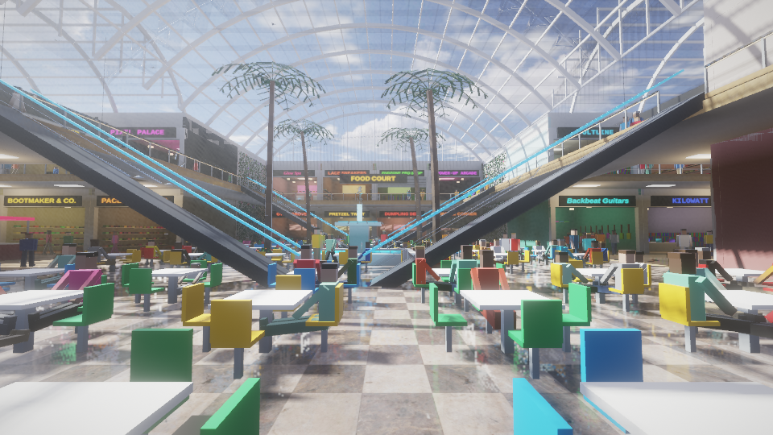

# Skylight Galleria

A two-level shopping mall you can walk through in the browser, under a glass barrel-vault roof with a real photographed sky. It runs on WebGPU, so open it in a recent Chrome or Edge.

## Live site

https://skylight-galleria.netlify.app opens an earlier version full screen. To redeploy, upload the contents of this folder (`index.html`, `js/`, `models/`, `assets/`, `_headers`) to the `skylight-galleria` Netlify site.

## Running it

Serve this folder over HTTP (for example `python3 -m http.server`) and open `index.html`. Opening the file directly from disk won't work, because the page fetches its photos from `assets/`.

Controls: you walk through the mall on foot, in first person.

| | Desktop | Phone |
|---|---|---|
| Look | Click to capture the mouse, then move it | Drag your finger |
| Move | W A S D or the arrow keys | Hold anywhere to walk forward |
| Run | Shift | Hold with two fingers |
| Jump | Space | |
| Ride | Step onto a glowing green pad at a fair ride; Space hops off early | Step onto the pad |

**Game controllers** work too (any pad the browser recognises): left stick or d-pad to walk, right stick to look, A to jump or hop off a ride, RB, RT or a stick click to run, Y to fly, B to fly down, X for day and night, Back to return to the main concourse, and Start for the menu.

The ⛶ button toggles full screen, and phones go full screen when you enter. Other keys: 1–6 jump to viewpoints, N switches day and night, F toggles flying, H shows stats, M mutes, and Esc opens the menu.

## What's in it

- **No flicker:** the lights stay steady.
- **Day and night:** each time you pass under one of the upper-level bridges, the sky fades between day and a starry night with the Milky Way and a full moon.
- **People:** each shopper has a face (eyes, eyebrows, nose, lips, ears), and some have long hair or beards. They wander the whole mall on a walking map. They ride the escalators, cross the bridges, take the loop corridors, go into shops to browse and eat at the food court. Cashiers stand at the counters. Shoppers vary in build, and some carry shopping bags or backpacks or wear coats, hats or glasses.
- **Sound:** it starts when you enter. Each shop plays its own style of music as you pass, and you can hear the fountains up close. Each district has its own background sound: birdsong and wind in the forest and the Arboretum, an underwater hum in the aquarium, splashing at the waterpark, a fairground organ at the fair, a waltz at the ice rink, arcade bleeps at the cinema, and wind and distant traffic outside.
- **Nature:** trees in the planters, palms around the fountain, living walls in the food court, birds circling above the roof, and drifting clouds whose shadows move across the floor.
- **No dead ends:** a shop-lined loop corridor on both floors joins the end of each wing to the side door of the department store at the end of the concourse, so every route carries on.
- **Escalators:** twelve in all. Four are in the food court, and two run up to and down from each of the four bridges.
- **Floors:** every area has its own stone or tile, with granite inlays.
- **Stores:** about 200 shops with made-up names. Their shelves hold packaged goods with printed labels: 256 different designs with invented brands, book titles and record sleeves. Shops also show real 3D items by type (clocks, vases and lanterns in home stores; cameras and laptops in electronics; cakes and pastries on food court counters).
- **Backrooms:** a small "Staff · Restrooms" door off each loop corridor leads down a flickering hallway to restrooms and a stockroom.

## Hidden finds

Every district hides one thing that's easy to miss. Bigfoot roams the back of the Arboretum; the rest are for you to find.

## Endless districts

You start outside, in the car park, facing the mall's grand entrance. Walk in through the **Grand Entrance** and straight down the main concourse, on either floor, to **The Grand Gate** at the far end, a two-storey hall with the glowing **Explore →** gate ahead. On the upper floor, bridges cross the food court and a wide staircase leads down to the gate.

Beyond the gate, the districts follow one after another in a straight line. Each has a single exit, straight ahead, into the next, and each is about a minute's walk deep. After you have seen all nine you reach the **Grand Exit**: a glass-roofed hall with a "Thank you for visiting" sign, and doors out to a car park full of cars. That's the end.

| District | What's there |
|---|---|
| The Arboretum | A glass conservatory with a lily pond, footbridge, palm house, rose gardens and tall photo-leaf trees. Somewhere in the back a Bigfoot wanders, rarely seen |
| Deep Blue Aquarium | A walk-through glass tunnel with schools of fish, manta rays, turtles, narwhals and a mermaid, plus coral wall tanks, glowing jellyfish, a bronze shark and a gift shop |
| Starlight Fair | A night-time fair where you can ride the Ferris wheel, carousel, teacups, roller coaster, drop tower and bumper cars, plus game booths and food stands |
| Old Town Market | An open-air market with lanes of stalls (bread, fruit, flowers, fish, cheese, crafts), cafe tables, a busker and string lights between brick buildings |
| Whispering Pines | A boardwalk through walls of tall pines, with a stream, ferns, fallen logs, mushrooms, a lookout tower you can climb and a picnic clearing |
| Hartwell & Co. | A three-floor department store around a skylit atrium, with named departments, escalators, chandeliers and a fountain |
| Glacier Ice Rink | Skaters circling a marked ice rink inside dasher boards, a scoreboard, skate rental, a cocoa cart, a giant decorated tree and a snowy village of chalets |
| Paramount Lights | A cinema with a concession hall, an arcade, a lounge, and two auditoriums you can walk into |
| Lagoon Splash | A waterpark with seven slides you can ride (walk onto the top of one), a sandy wave pool, a lazy river around an island, a kids' splash zone and cabanas |

The map is fixed: the same districts, in the same order, laid out the same way, for everyone and on every visit. The order is set in `js/route.js`: Old Town Market, Hartwell & Co., Deep Blue Aquarium, The Arboretum, Whispering Pines, Glacier Ice Rink, Paramount Lights, Starlight Fair, Lagoon Splash, then the Grand Exit. Press R at any time to go back to the main concourse and walk the line again.

## How it looks real

- **Sky:** a 4K HDR photo of a partly cloudy sky. The sun's direction and brightness, and the sky's ambient light, are measured from the photo.
- **Sun:** casts shadows through the glass roof, including the steel ribs, and lights visible shafts in the air.
- **Surfaces:** photo-scanned marble, granite, wood and plaster, with normal and roughness maps.
- **Reflections:** the polished floors pick up reflections of what's on screen.
- **Ambient light:** a GPU pass works out how much sky each spot in the mall can see, so daylight fades naturally into the shops.

## Speed

The mall only draws what is in front of the camera. Everything is grouped into 16 m cells when an area loads, and cells outside the view are skipped each frame. Shadows, sky light and reflections still use the whole scene, so nothing looks different. Furniture and props also switch to lighter versions once they are far enough away that the difference is smaller than a pixel. Together these cut the triangles drawn per frame by about 3× in the mall and 7–11× in the market and department store. Add `?nocull` to the address to turn both off for comparison.

## How the code is organized

No build step: `index.html` loads plain script files in order.

| File | What it does |
|---|---|
| `js/sky.js` | Sun direction and sky lighting measured from the two sky photos |
| `js/shaders.js` | All WebGPU shaders: surfaces, sky, glass and water, people and rides, reflections, light shafts, tone mapping |
| `js/world.js` | Building blocks (boxes, shops, trees, fountains, escalators…), the hub mall, and the toolkit `K` handed to districts |
| `js/districts/*.js` | One file per district. Each registers `DISTRICTS.name=function(K){…}` and builds in its own 120 × 140 m frame: enter at (0,0) facing +z and leave at (0,140) into the next district. `lot.js` holds the starting car park and the Grand Exit, which are not in the rotation |
| `js/models.js`, `models/` | Poly Haven props and leaf cards, built by `tools/build_models.py` into one geometry file and texture layers. Then `tools/build_lods.mjs` adds lighter far-away versions (`cd tools && npm install && node build_lods.mjs`) |
| `js/route.js` | The fixed order of the districts along the line |
| `js/engine.js` | Loading, streaming districts in and out, collision, walking, the crowd, audio, controls and the render loop |

Each area is built by its own file from a fixed seed (taken from its name), so it comes out the same every time. To upgrade an area, edit its file; everyone sees the change. To add a new area, copy a district file, rename the function, add a `<script>` tag for it in `index.html`, and put its name in `js/route.js` where you want it in the line.

## Credits

Sky and textures are from [Poly Haven](https://polyhaven.com) under CC0:
- kloofendal_48d_partly_cloudy_puresky (Greg Zaal, Jarod Guest)
- rogland_clear_night (Greg Zaal)
- marble_01 (Rob Tuytel)
- granite_tile (Charlotte Baglioni)
- wood_floor (Dimitrios Savva)
- painted_plaster_wall (Amal Kumar)
- floor_tiles_06, large_floor_tiles_02, floor_tiles_08, cobblestone_floor_04, blue_floor_tiles_01, red_brick_03, forest_leaves_02 (Rob Tuytel)
- leafy_grass (Charlotte Baglioni)
- weathered_brown_planks (Dimitrios Savva, Rico Cilliers)
- granite_tile_03 (Charlotte Baglioni)
- herringbone_parquet (Jenelle van Heerden, Sergej Majboroda)
- sand_01, snow_02 (Rob Tuytel), rock_wall_08 (Amal Kumar), coral_ground_02 (Rob Tuytel)

3D models and leaf textures are also from Poly Haven (CC0): WoodenChair_01, ArmChair_01, Sofa_01, Ottoman_01, CoffeeTable_01, WoodenTable_02, bar_chair_round_01, modern_coffee_table_01, Barrel_01, barrel_03, wooden_crate_01, planter_pot_clay, ceramic_vase_02, Chandelier_01, hanging_industrial_lamp, steel_frame_shelves_01/02, Shelf_01, wooden_bookshelf_worn, CashRegister_01, CoffeeCart_01, WetFloorSign_01, Television_01, boombox, lifebuoy, croissant, lemon, Ukulele_01, bronze_whale_statue, bronze_shark_statue, fern_02, moss_01, and leaves and bark from fir_tree_01, pine_tree_01, island_tree_01, jacaranda_tree, shrub_01 and grass_medium_01.
