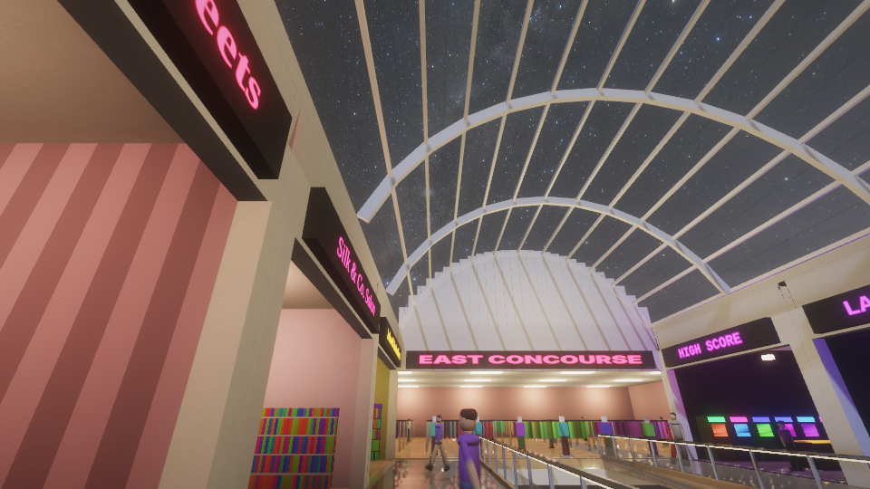

# Skylight Galleria

A two-level shopping mall you can walk through in the browser, under a glass barrel-vault roof with a real photographed sky. It runs on WebGPU, so open it in a recent Chrome or Edge.

## Live site

https://skylight-galleria.netlify.app opens it full screen. To redeploy, upload the contents of this folder (`index.html`, `assets/`, `_headers`) to the `skylight-galleria` Netlify site.

## Running it

Serve this folder over HTTP (for example `python3 -m http.server`) and open `index.html`. Opening the file directly from disk won't work, because the page fetches its photos from `assets/`.

Controls: you walk through the mall on foot, in first person.

| | Desktop | Phone |
|---|---|---|
| Look | Click to capture the mouse, then move it | Drag your finger |
| Move | W A S D or the arrow keys | Hold anywhere to walk forward |
| Run | Shift | Hold with two fingers |
| Jump | Space | |

The ⛶ button toggles full screen, and phones go full screen when you enter. Other keys: 1–6 jump to viewpoints, N switches day and night, F toggles flying, H shows stats, M mutes, and Esc opens the menu.

## What's in it

- **Day and night:** each time you pass under one of the upper-level bridges, the sky fades between day and a starry night with the Milky Way and a full moon.
- **People:** each shopper has a face (eyes, eyebrows, nose, lips, ears), and some have long hair or beards. They wander the whole mall on a walking map. They ride the escalators, cross the bridges, take the loop corridors, go into shops to browse and eat at the food court. Cashiers stand at the counters.
- **Sound:** it starts when you enter. Crowd chatter gets louder near people, each shop plays its own style of music as you pass, and you can hear the fountains up close.
- **Nature:** trees in the planters, palms around the fountain, living walls in the food court, birds circling above the roof, and drifting clouds whose shadows move across the floor.
- **No dead ends:** a shop-lined loop corridor on both floors joins the end of each wing to the side door of the department store at the end of the concourse, so every route carries on.
- **Escalators:** twelve in all. Four are in the food court, and two run up to and down from each of the four bridges.
- **Floors:** every area has its own stone or tile, with granite inlays.
- **Stores:** about 200 shops with made-up names.

## How it looks real

- **Sky:** a 4K HDR photo of a partly cloudy sky. The sun's direction and brightness, and the sky's ambient light, are measured from the photo.
- **Sun:** casts shadows through the glass roof, including the steel ribs, and lights visible shafts in the air.
- **Surfaces:** photo-scanned marble, granite, wood and plaster, with normal and roughness maps.
- **Reflections:** the polished floors pick up reflections of what's on screen.
- **Ambient light:** a GPU pass works out how much sky each spot in the mall can see, so daylight fades naturally into the shops.

## Credits

Sky and textures are from [Poly Haven](https://polyhaven.com) under CC0:
- kloofendal_48d_partly_cloudy_puresky (Greg Zaal, Jarod Guest)
- rogland_clear_night (Greg Zaal)
- marble_01 (Rob Tuytel)
- granite_tile (Charlotte Baglioni)
- wood_floor (Dimitrios Savva)
- painted_plaster_wall (Amal Kumar)
- floor_tiles_06, large_floor_tiles_02, floor_tiles_08 (Rob Tuytel)
- granite_tile_03 (Charlotte Baglioni)
- herringbone_parquet (Jenelle van Heerden, Sergej Majboroda)
